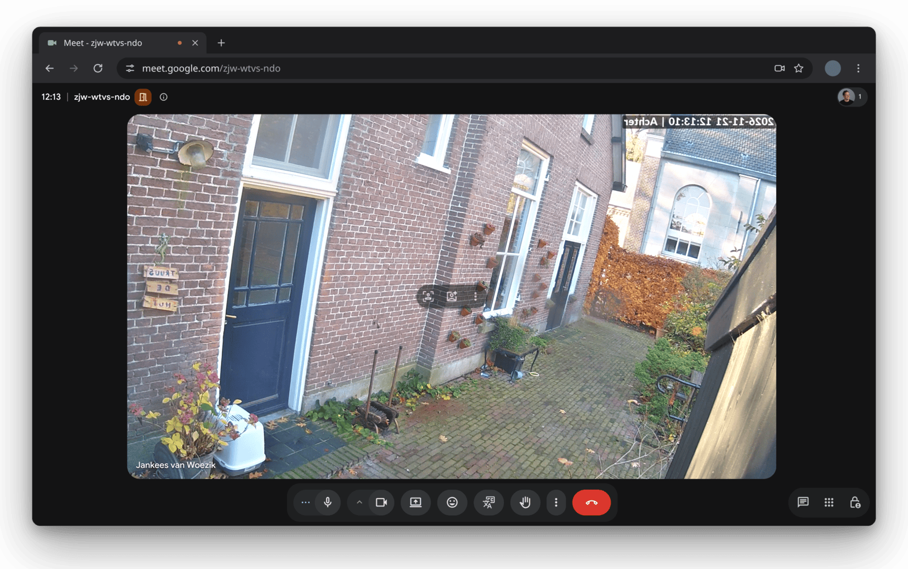

# UniFi Protect Webcam

An [Omarchy](https://omarchy.org) bar widget that turns a [UniFi Protect](https://ui.com/protect) camera into a webcam. Switch a camera on in the panel and Meet, Zoom, Slack and every other app see it as an ordinary camera called **UniFi Protect**.



Meet mirrors your own preview, which is why the camera's timestamp reads backwards above; everybody else in the call sees it the right way round.

Switch another camera on and the same webcam shows that one instead, so a call that already picked "UniFi Protect" never has to pick again. While the console reboots or the network hiccups, the last picture stays up rather than the camera vanishing from the call.

## Install

```bash
omarchy plugin add https://github.com/jankeesvw/omarchy-unifi-protect-webcam.git --enable
```

Then three things, once. The panel walks you through all of them.

### 1. The virtual camera

The webcam is a [v4l2loopback](https://github.com/umlaeute/v4l2loopback) device at `/dev/video42`. Making one takes root, and the plugin never asks for root itself: run these in a terminal. The panel shows the same lines with a button that copies them.

```bash
sudo pacman -S --needed v4l2loopback-dkms v4l2loopback-utils
sudo tee /etc/systemd/system/unifi-protect-webcam.service >/dev/null <<'EOF'
[Unit]
Description=Virtual camera for the UniFi Protect Webcam plugin
After=systemd-modules-load.service

[Service]
Type=oneshot
RemainAfterExit=yes
ExecStartPre=/bin/sh -c 'if /usr/bin/modprobe -c | /usr/bin/grep -q "^options v4l2loopback "; then exec /usr/bin/modprobe v4l2loopback; else exec /usr/bin/modprobe v4l2loopback devices=0; fi'
ExecStart=/usr/bin/v4l2loopback-ctl add --name "UniFi Protect" --exclusive-caps 1 /dev/video42
ExecStop=/usr/bin/v4l2loopback-ctl delete /dev/video42

[Install]
WantedBy=multi-user.target
EOF
echo 'SUBSYSTEM=="video4linux", KERNEL=="video42", TAG+="uaccess"' | sudo tee /etc/udev/rules.d/70-unifi-protect-webcam.rules >/dev/null
sudo udevadm control --reload-rules
sudo systemctl daemon-reload
sudo systemctl enable --now unifi-protect-webcam.service
```

Both files are written out in full here rather than copied from the plugin's directory, so nothing root installs comes from a place your own account can change.

The first line installs the module and the tool that adds devices to it. The service adds one device named "UniFi Protect" next to whatever v4l2loopback devices you already have, and removes it again when stopped. If nothing on your machine configures v4l2loopback, it loads the module with `devices=0`, so you do not also get the empty "Dummy video device" the module makes by default; if something does, those options are left alone. `exclusive-caps` is what makes Chrome offer the device as a camera at all.

The udev rule tags that one device `uaccess`, which hands it to whoever is logged in at the screen. No group membership, and no permissions opened to other accounts.

### 2. An API key

Make one at `https://<your-console>/unifi-api/protect`. The plugin only lists cameras, reads a camera's name and reads its stream address, so a key made for a local user with **Protect: View Only** is all it needs. Paste it into the panel; it is written to `~/.config/unifi-protect-webcam/api-key` over stdin, never on a command line.

Each camera needs an RTSP stream switched on in Protect, under the camera's settings, Advanced. The plugin does not switch one on for you, because that would need a key that can change your console.

### 3. Pin the console

The console signs its own certificate, so there is nothing to check it against. The panel shows its SHA-256 fingerprint; compare it with what your browser shows for `https://<your-console>` and trust it. From then on the plugin only talks to a console presenting that exact certificate: the API key is sent after the certificate has been compared, and the video stream is verified against it as well. A console that starts presenting another certificate gets nothing until you have looked at the new one.

## Using it

Left-click the camera icon for the panel. Every camera has a switch; switching one on makes it the webcam, switching it off removes the webcam from the list in your calls. Right-click the icon to switch the last camera on or off without opening anything.

The icon lights up while a call can see the camera.

Keys in the panel: arrows or `j`/`k` to choose a camera, Enter or space to switch it, `r` to reload the list, `,` for the console and key, Esc to close.

From a terminal:

```bash
bin/unifi-protect-webcam cameras --host 192.168.1.1
bin/unifi-protect-webcam on --host 192.168.1.1 <camera-id>
bin/unifi-protect-webcam off
bin/unifi-protect-webcam status
```

## How it works

Protect hands out an RTSPS address for the camera. ffmpeg opens it, verified against the pinned certificate, decodes it, and scales and crops it to 1920x1080 (or 1280x720). The frames come back to `bin/unifi-protect-webcam` on a pipe, and that writes them into `/dev/video42`.

The helper holds the device, not ffmpeg, and that is on purpose. A v4l2loopback device only counts as a camera while something has it open for writing, and a browser that looks while nothing does reports no camera at all. ffmpeg comes and goes; the helper stays, and keeps writing the last picture whenever there is no new one.

The feed runs as its own process, so restarting the shell does not take a call's camera with it. It stops when you switch it off.

There is no sound: the camera's microphone is not passed through, and your own microphone stays your microphone.

## What it stores and sends

- `~/.config/unifi-protect-webcam/api-key`: your API key, mode 600.
- `~/.config/unifi-protect-webcam/gateway.pem`: the console's certificate you pinned.
- `$XDG_RUNTIME_DIR/unifi-protect-webcam/`: the running feed's state and a short log. Gone at logout.
- Settings (console address, picture size, the last camera) in the widget's entry in `~/.config/omarchy/shell.json`.

It talks to the console you configured and nothing else: the integration API on port 443 and the camera's RTSPS stream on 7441.

While a camera is switched on, its stream address is on ffmpeg's command line, and other accounts on this computer can read a process's command line. The address gives access to that one camera's video. On a single-user machine that is you; on a shared one, keep it in mind.

## Removing

```bash
bin/unifi-protect-webcam off
sudo systemctl disable --now unifi-protect-webcam.service
sudo rm /etc/systemd/system/unifi-protect-webcam.service /etc/udev/rules.d/70-unifi-protect-webcam.rules
sudo udevadm control --reload-rules
omarchy plugin remove jankeesvw.unifi-protect-webcam
```

That leaves `~/.config/unifi-protect-webcam` with your key and the pinned certificate; delete that directory yourself if you want them gone. The v4l2loopback packages stay installed, since other things may use them.

## License

MIT
